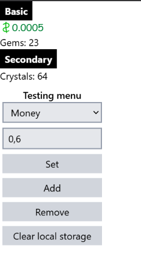
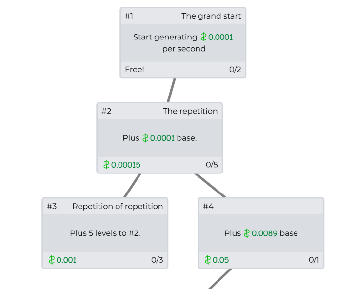
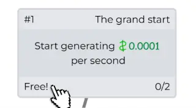

# Website incremental game
is a project i made using Vite, React, TypeScript, TailWind. Published it with github pages (Github actions).

### How to play:
Open the game [website](https://d9m9nt9d.github.io/incremental-2/).
On the left side you should see your currencies, like money, gems, and testing menu that i forgot to remove. 
 
In the middle you should see upgrades, the main part of the game 
 
you buy those upgrades to boost your currencies gain, like every incremental game.
> [!NOTE]
> To buy an upgrade click the lowest rectangle where the cost is displayed.  
> 

> [!TIP]
> Right click to buy maximum amount of levels you can afford. 

That's pretty much everything you need to know to playtest the game. It doesn't have much content because im using Vite, React with TypeScript and TailWind for the first time.
